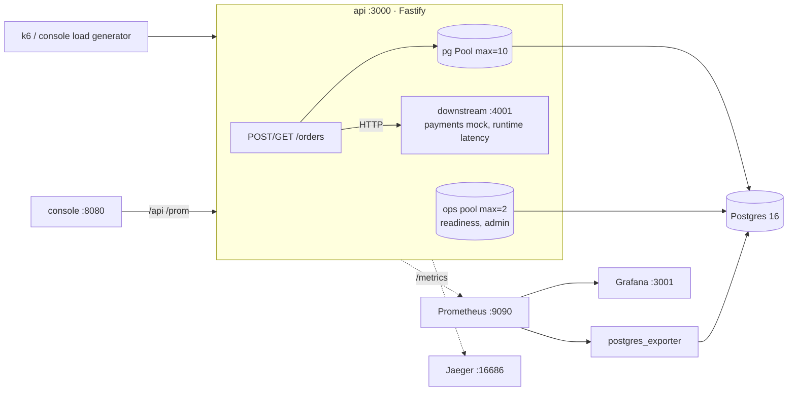

# PoolSide

A small order service with a planted production failure, and the observability needed to
find it. `POST /orders` holds a Postgres connection inside an open transaction while it calls
a payments provider over HTTP. Under light load everything is fine. When the provider slows
to ~1.5 s during a traffic spike, the 10-connection pool is exhausted and about two thirds of
all requests fail, including order lookups and health checks that never touch the provider.
App CPU, memory and database load stay low. The repo contains the service, the diagnosis
written as if the cause were unknown, the fix (`TX_STRATEGY=release`), defense in depth,
real before/after evidence, and an operator console for demoing it.



## Quickstart

```bash
make up
```

| | URL |
|---|---|
| Operator console | http://localhost:8080 |
| Grafana, "Service Overview" (anonymous, read-only) | http://localhost:3001 |
| Jaeger | http://localhost:16686 |
| Prometheus | http://localhost:9090 |
| API | http://localhost:3000 |

`make help` lists every target. `make down` stops everything and deletes the volumes.

## Reproduce in 3 commands

```bash
make up
make break && make load-spike     # provider → 1.5 s ± 0.5 s, then 10 → 40 rps: ~66% errors
make fix && make load-spike       # TX_STRATEGY=release at runtime: 0% errors
```

`make reset` returns to the start (provider 50 ms, `TX_STRATEGY=hold`). Details and expected
output: [docs/REPRODUCE.md](docs/REPRODUCE.md).

## Results (real runs: [docs/evidence](docs/evidence/README.md))

| Spike: 10 → 40 rps, provider 1.5 s ± 0.5 s | `hold` (original) | `release` (fix) |
|---|---:|---:|
| Error rate | 66.3% | **0.0%** |
| Successful req/s | 8.8 | **26.7** |
| p95 / p99, all requests | 2.69 s / 2.91 s | 1.93 s / 1.99 s |
| `GET /orders/:id` p95 | 1.01 s | **9 ms** |
| `/health` p95 | 1.01 s | **10 ms** |
| Pool waiting / `idle in transaction` at peak | 40 / 10 | **0 / 0** |

Order latency in `release` still follows the provider, because an order can't finish before
its payment does. The fix removes the amplification from "one slow dependency" to "every
route fails".

## Documentation

| | |
|---|---|
| [ARCHITECTURE.md](docs/ARCHITECTURE.md) | Components, request flow for both strategies, what was deliberately not built |
| [REPRODUCE.md](docs/REPRODUCE.md) | Exact steps, expected symptoms, the (unhelpful) API responses |
| [INVESTIGATION.md](docs/INVESTIGATION.md) | Debugging timeline: symptoms → hypotheses (4 refuted, 1 confirmed) → root cause |
| [POSTMORTEM.md](docs/POSTMORTEM.md) | Blameless postmortem: trigger vs cause, the fix vs "raise the pool size" |
| [INSTRUMENTATION.md](docs/INSTRUMENTATION.md) | Every metric, log field, span and health check, and how each surfaces other failures |
| [PREVENTION.md](docs/PREVENTION.md) | Alert rules (PromQL), the no-I/O-in-transactions rule and guard, load testing in CI, Little's law |
| [RUNBOOK.md](docs/RUNBOOK.md) | On-call triage for "latency high / 5xx spike" |
| [DEMO_SCRIPT.md](docs/DEMO_SCRIPT.md) | 3–5 minute recording plan |
| [evidence/](docs/evidence/README.md) | k6 outputs, pg_stat_activity snapshots, traces, screenshots, before/after table |

## Repository layout

```
apps/api          Fastify service: strategies/{hold,release}.ts, instrumented pool, metrics, tracing
apps/downstream   payments mock with runtime latency / jitter / error rate
apps/console      React operator console (Vite, Tailwind tokens, Recharts)
db/migrations     plain SQL, applied by db/migrate.sh
infra             prometheus.yml, Grafana provisioning + dashboard JSON, nginx config
load              k6 scripts (baseline, spike, slow-downstream)
scripts           evidence capture, pg_stat_activity snapshot, screenshots, before/after table
docs              the documents above + evidence
```

## Development

```bash
npm ci
npm run check              # lint + typecheck + unit tests
make up && make test-integration   # needs the compose Postgres
npm run dev -w @poolside/console   # console with hot reload against the compose stack
```

CI (`.github/workflows/ci.yml`): lint, typecheck, unit tests, integration tests against a
Postgres service, docker build; a nightly/manual k6 load test against a slow provider.

## Trade-offs

Non-obvious choices, in the order they were made:

1. **npm workspaces monorepo**, with one Dockerfile per app built from the repo root. Boring,
   and no extra tool (pnpm/turbo) to explain.
2. **Strategies as a module boundary** (`hold.ts` / `release.ts`, same signature) plus a
   **runtime switch** (`PUT /admin/strategy`) on top of the `TX_STRATEGY` env var. The diff
   is readable, and the demo can flip it mid-incident without a restart.
3. **Fix = pending row + idempotency key**, not "call the provider first, then one
   transaction". It keeps a record of every attempt, at the cost of a visible `pending` state.
4. **All DB access goes through an explicit, timed acquire** instead of `pool.query()`, so
   pool wait is never reported as query time.
5. **Connection hold time as its own histogram.** It isn't in the brief, but "hold ≫ query"
   is the most direct signature of I/O inside a transaction.
6. **A separate 2-connection ops pool** for readiness and admin endpoints: they must work
   while the main pool is exhausted. It costs 2 extra Postgres connections per replica.
7. **The original `/health` is kept** on the main pool, to demonstrate the trap next to
   the corrected `/health/live` + `/health/ready`.
8. **Defenses that are pool-wide apply to both strategies** (acquire timeout → 503,
   idle-in-transaction timeout). So today `hold` fails with a typed 503, not the original
   opaque 500. Retries and timeouts on the provider call are `release`-only, because in
   `hold` they would lengthen the time a connection is held.
9. **OTLP straight to Jaeger all-in-one**, with no collector: one fewer component.
10. **Prometheus scrapes every 2s** so demo graphs react quickly. Gauges are sampled, so
    peaks between scrapes are missed (the histograms still catch them).
11. **Histogram buckets are coarse in the 1–2.5 s range**, so p99 values there are
    interpolated (see the evidence README caveat). Finer buckets cost series.
12. **postgres_exporter added** so `idle in transaction` is graphable, not only visible via psql.
13. **Console reads Prometheus directly** (same PromQL as Grafana) instead of a backend-for-frontend.
14. **nginx injects the admin token server-side**, so it never ships in the JS bundle. The
    console port is bound to `127.0.0.1` because anyone who can reach it effectively has admin.
15. **In-browser load generator shards across `lg0-9.localhost`** to get past the browser's
    ~6 connections per origin. k6 remains the source of truth for evidence.
16. **Tailwind 3 with a JS config** mapping every color to a CSS custom property, which is
    more explicit than v4's CSS-first config.
17. **k6 runs in a container** (compose `tools` profile), so there's nothing to install.
18. **Screenshots are taken outside measured runs.** Rendering browsers on the same laptop
    perturbed the measurements (`docs/evidence/observer-effect/`).

## Known limitations and failure cases

- **Orders can be left `pending`** if the process dies between the provider call and the
  final UPDATE. The idempotency key makes a reconciler safe, but none is built.
- **No overall request deadline.** With a dead provider, `release` can take ≈ 3 attempts × 3 s
  plus backoff ≈ 9–10 s. Next step: deadline propagation and a circuit breaker.
- **The payments mock's idempotency store is in memory** (last 10k keys); a restart forgets them.
- **The network-I/O-in-transaction guard** only sees transactions opened through
  `timedQuery('begin' | 'commit' | 'rollback')` and calls made through the payments client.
- **Single API replica.** The capacity maths for replicas is in PREVENTION.md, not demonstrated.
- **Demo-grade admin auth:** one static bearer token; the console proxy grants it to anyone on localhost.
- **In-memory state:** Jaeger storage, the API's recent-requests buffer and the console
  timeline are all lost on restart.
- **Laptop numbers.** Absolute latencies vary by machine. Heavy concurrent work on the same
  machine (e.g. browsers) visibly perturbs results.
- `*.localhost` sharding needs a browser that resolves subdomains of localhost to loopback
  (Chrome, Firefox). Elsewhere the load generator falls back to ~6 concurrent requests and says so.

## Tools and AI used

- **Runtime:** Node 22, TypeScript 5.9 (strict), Fastify 5, node-postgres 8, pino 10,
  prom-client 15, OpenTelemetry JS SDK (sdk-node 0.300, http/undici/pg instrumentations),
  Postgres 16, Prometheus 3.5, Grafana 12.1, Jaeger 2.9, postgres_exporter 0.17, nginx 1.29.
- **Console:** React 18, Vite 7, Tailwind CSS 3.4, Recharts 2.15, lucide-react,
  Inter / JetBrains Mono via Fontsource.
- **Testing and load:** vitest 3, k6 2.3 (container), Playwright 1.64 (screenshots and UI checks).
- **AI:** built with **Claude Code (Anthropic, Claude Opus 5.5)** as a pair programmer.
  I set the brief, design constraints and review bar. Claude proposed the plan, wrote the
  code, docs and scripts in small reviewed commits, and ran every scenario to collect the
  evidence. Every number in the docs comes from those runs. Design decisions and their
  rationale are listed above so they can be defended (or changed) independently of who typed them.
