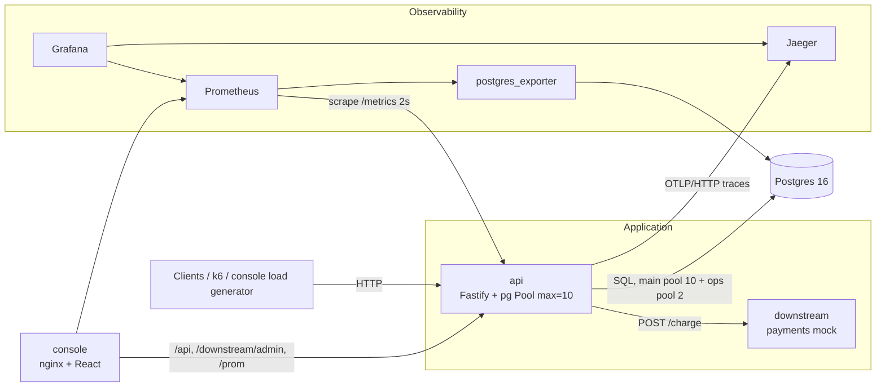
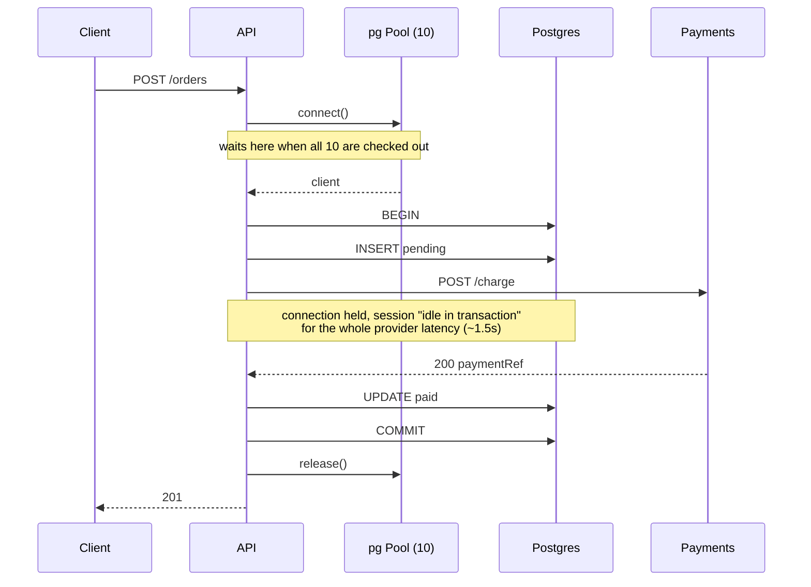
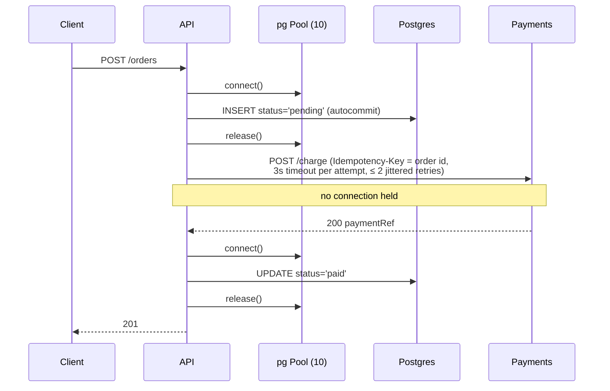

# Architecture

## Components

| Component | Why it exists |
|---|---|
| `apps/api` | The service under investigation. `POST /orders`, `GET /orders/:id`, health checks, admin endpoints, `/metrics`. |
| `apps/downstream` | A payments provider we don't control. Latency, jitter and error rate change at runtime (`PUT /admin/latency`), so a bad day for the provider can be simulated without restarts. Dedupes on `Idempotency-Key` like real providers do. |
| Postgres 16 | The shared dependency. The table and query are trivial on purpose, so the database is never the bottleneck. |
| `migrate` | One-shot container that applies `db/migrations/*.sql` with `psql`. No migration framework to explain. |
| Prometheus | Metrics store. Scrapes the API and postgres_exporter every 2s, which is aggressive and chosen so demo graphs react quickly. |
| postgres_exporter | Turns `pg_stat_activity` into `pg_stat_activity_count{state}`, so "idle in transaction" shows on a graph. |
| Grafana | Provisioned "Service Overview" dashboard (`infra/grafana`); nothing is configured by clicking. |
| Jaeger | Trace store and UI. All-in-one v2 accepts OTLP directly, so no collector is needed. |
| `apps/console` | Operator console for demos: live KPIs from Prometheus, scenario controls, request explorer, DB sessions, incident timeline. |
| k6 (`tools` profile) | Load generation from a container. Its outputs are the evidence of record. |

## Request flow: `POST /orders`

The two strategies live in `apps/api/src/orders/strategies/{hold,release}.ts`
and share one signature, so `routes.ts` doesn't know which one runs.
`TX_STRATEGY` sets the boot value and `PUT /admin/strategy` changes it at runtime.

### `hold` (original)

Connections in use ≈ order RPS × provider latency. At 1.5s per call, 10
connections serve about 6.7 orders/s. Above that, every caller of the pool
queues, including `GET /orders/:id` and `/health`, which never touch the provider.

### `release` (fix)

Each checkout lasts milliseconds, so pool demand no longer depends on provider latency.
The cost is that `pending` becomes a real, visible state (see Known limitations in the README).

## Inside the API

| Module | Responsibility |
|---|---|
| `db/instrumented-pool.ts` | The only way code gets a connection. Times acquire separately from SQL, records hold time, opens the `db.pool.acquire` / `db.connection.held` spans, converts pg's pool timeout into `PoolAcquireTimeoutError`, and guards checked-out clients against `'error'` events. |
| `db/ops-pool.ts` | A separate 2-connection pool for readiness and admin views, so they keep working while the main pool is exhausted. |
| `obs/request-context.ts` | `AsyncLocalStorage` per request: request id, trace id and the acquire/query/downstream time accumulators. |
| `obs/http-hooks.ts` | Request id in and out, one log line per request, HTTP histogram, recent-requests buffer. |
| `downstream/payments-client.ts` | `charge()` (original: single attempt, no timeout) and `chargeWithRetry()` (timeout + bounded retries). |
| `errors.ts` | Typed errors mapped to HTTP: pool timeout → 503 + `Retry-After`, provider failure → 502, anything else → opaque 500. |

## What I deliberately did not build

- **No ORM or query builder.** Three SQL statements don't need one, and it would hide which queries run.
- **No OpenTelemetry Collector.** The API exports straight to Jaeger. In production a collector would batch, sample and fan out.
- **No outbox worker or reconciler** for orders left `pending` by a crash. The design accounts for it (idempotency key), but it is out of scope; see Known limitations.
- **No auth on public routes, and no TLS.** Not relevant to the failure being studied.
- **No Alertmanager.** Alert rules are written out in [PREVENTION.md](PREVENTION.md) but not deployed, to keep the stack small.
- **No horizontal scaling.** One API replica makes the pool arithmetic easy to see; [PREVENTION.md](PREVENTION.md) covers how replicas change the maths.
